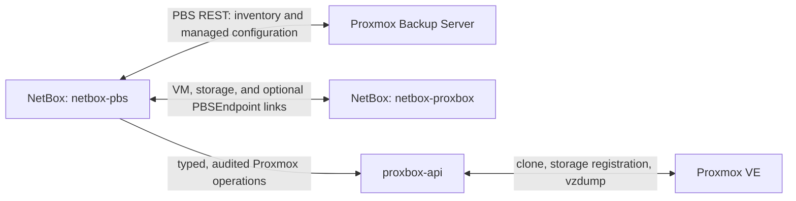

# netbox-pbs — Proxmox Backup Server

`netbox-pbs` is a standalone NetBox plugin for Proxmox Backup Server (PBS). It
reads PBS inventory and configuration through the PBS REST API, manages selected
PBS configuration under explicit write permissions, and records tasks and audit
events. It reuses NetBox and `netbox-proxbox` objects for virtual machines,
addresses, templates, nodes, storage, networks, and the optional PBS endpoint
link. It does not copy those objects into another inventory.

For the full contract, use the [netbox-pbs documentation](https://github.com/emersonfelipesp/netbox-pbs/tree/main/docs),
especially its [models](https://github.com/emersonfelipesp/netbox-pbs/blob/main/docs/models.md),
[API](https://github.com/emersonfelipesp/netbox-pbs/blob/main/docs/api.md),
[sync](https://github.com/emersonfelipesp/netbox-pbs/blob/main/docs/sync.md),
[deployment](https://github.com/emersonfelipesp/netbox-pbs/blob/main/docs/deployment.md), and
[backup](https://github.com/emersonfelipesp/netbox-pbs/blob/main/docs/backup.md) guides.

## Integration boundaries

`PBSServer` owns the PBS address, TLS policy, token identity, and write policy.
Its token secret stays in the `netbox-pbs` secret store. The optional
`netbox-proxbox` `PBSEndpoint` is an inventory link: **Register in netbox-proxbox**
matches or creates an endpoint for the same host and port but does not copy a
PBS token or secret to Proxbox or proxbox-api. A deployed PBS may also link to
its existing NetBox `VirtualMachine` and `IPAddress`.

`netbox-pbs` uses proxbox-api for the Proxmox side of a PBS deployment, for
registering a PBS datastore as Proxmox storage, and for running a Proxmox VM
backup. PBS itself has no snapshot-creation API; Proxmox VE writes the backup.
The resulting PBS snapshot appears when `netbox-pbs` next syncs that server.

## Inventory and synchronization

`PBSSyncJob` reads each configured server directly. An operator can run **Sync
now** or `POST /api/plugins/pbs/servers/<id>/sync/`; an optional schedule can
enqueue a full sync. The stages run in order: `node`, `datastores`, `namespaces`,
`groups`, `snapshots`, `jobs`, `objects`, and `tasks`. A failed read leaves that
stage's rows untouched. Managed configuration keeps desired and observed state;
new or changed PBS values may report drift, while pending writes remain protected.
Reflected snapshots, groups, and tasks are refreshed from PBS.

| Model | Role |
| --- | --- |
| `PBSServer` | Connection, TLS, write policy, health, and optional VM, IP, and Proxbox endpoint links |
| `PBSDatastore`, `PBSNamespace` | Managed datastore configuration and namespace inventory |
| `PBSJob`, `PBSManagedObject` | Managed jobs and typed PBS configuration, including users, tokens, and ACLs |
| `PBSBackupGroup`, `PBSSnapshot` | Reflected backups; snapshot identity includes the namespace |
| `PBSTask`, `PBSActionLog` | Task status and audited actions |
| `PBSDeployment` | Staged deployment and adoption of a PBS virtual machine |
| `PBSPluginSettings` | Sync, branching, secret backend, and scheduling settings |

Backup groups link to a NetBox virtual machine only when the backup evidence
identifies one guest. Snapshots link to the exact group by server, datastore,
namespace, backup type, and backup ID. Matching Proxbox storages and `VMBackup`
rows are computed relationships subject to the viewer's permissions; they are
not copied into `netbox-pbs`. An ambiguous VM match leaves the link empty.

Optional `netbox-branching` runs a sync in a branch. The setting
`branch_on_conflict` is `fail` or `acknowledge`; a failed stage or unavailable
branching runtime does not silently write to the main schema. See the
[netbox-pbs configuration guide](https://github.com/emersonfelipesp/netbox-pbs/blob/main/docs/configuration.md)
for the current settings and defaults.

## Managed writes and secrets

PBS writes require the server's **Allow writes** setting and the applicable
NetBox object and action permissions. A managed create or update enters
`pending` state and queues an apply job. A managed delete requires the exact
object identity as confirmation. A PBS ACL entry is identified by its path,
principal, and role; changing one creates a different entry. Secrets are
write-only in normal forms and REST responses. Selected once-returned managed
object secrets have a separate permission-gated, audited reveal action; the
server connection token cannot be revealed there.

The old `proxbox_api_url` and `proxbox_api_key` settings are deprecated and
unused by synchronization. They remain temporarily for migration reversal.
Legacy `proxbox_api_key_enc` ciphertext, when present, is covered by
`netbox-proxbox` encryption-key rotation and recovery safeguards. Migrate the
companion before rotating or resetting that shared legacy key. New secrets are
stored through the `netbox-pbs` secret store.

## Navigation and REST API

The **PBS** menu includes servers, deployments, datastores, snapshots, jobs,
typed configuration, tasks, audit log, and plugin settings. Permissions control
which entries and objects an operator can see.

The REST prefix is `/api/plugins/pbs/`. The principal collections are
`/servers/`, `/deployments/`, `/datastores/`, `/namespaces/`, `/jobs/`,
`/objects/`, `/groups/`, `/snapshots/`, `/tasks/`, `/audit-log/`, and
`/settings/`. Groups, snapshots, tasks, and audit rows are read-only. The
server, deployment, and datastore action routes and their permissions are
listed in the [netbox-pbs API guide](https://github.com/emersonfelipesp/netbox-pbs/blob/main/docs/api.md).

## Installation

Install `netbox-proxbox` first, then install and enable `netbox-pbs`. Put
`netbox_proxbox` before `netbox_pbs` in NetBox's `PLUGINS` list. Run the
`netbox_pbs` migrations and restart the application and workers. No
`PLUGINS_CONFIG` entry is required; edit the singleton at **PBS → Plugin
settings**. If `netbox-pdm` is installed too, enable `netbox_pbs` before
`netbox_pdm` because PDM links to PBS server records.

The older companion schema must be upgraded to `netbox-pbs` `0.0.1.post1` or
later before `netbox-proxbox` encryption-key recovery. See the
[netbox-pbs installation guide](https://github.com/emersonfelipesp/netbox-pbs/blob/main/docs/installation.md)
and the [compatibility matrix](https://github.com/emersonfelipesp/netbox-pbs/blob/main/COMPATIBILITY.md)
for the current supported NetBox versions and dependency pairing.
